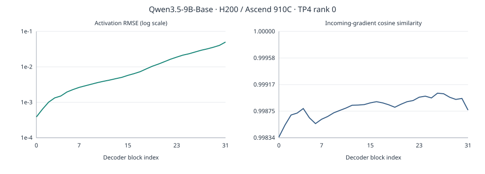

# 修复后追踪：32 层轨迹与首次输入投影隔离

模型为 Qwen3.5-9B-Base，两端沿用原环境、模型、固定轨迹和已验证的 zero-centered gamma 修复。本轮采集 32 个文本 decoder block 的输出及传入梯度，并细看第 0 层 GDN 的首次输入投影。

## 从层间到算子

两端 TP4 共 8 个 rank 均完成原生前向和反向；输入、action scores 和 objective 精确复现前次记录。数值轨迹保存 rank 0 的 33 个对应边界。

| 边界 | 激活跨端 RMSE | 最大绝对差异 |
| --- | ---: | ---: |
| 第 0 层输入 | 0 | 0 |
| 第一次归一化/投影输出 | 0.000423104361044838 | 0.0625 |
| 第 0 层输出 | 0.00038611411477766096 | 0.0625 |
| 第 31 层输出 | 0.050187378548939614 | 4 |

首次投影的输入和 gamma 逐值一致。源端保留的 gamma、`[3088,4096]` 投影权重分片也有相同 SHA256。

## 独立重放与高精度参照

分别构造两端原生 LayerNormLinear，使用相同捕获输入与原权重分片，并返回内部归一化输出。两端隔离模块都在全部 586,720 个坐标上逐值复现各自原模型投影输出。各侧的原生归一化后接 torch linear，也逐值复现该侧组合模块。

- 归一化输出跨端有 7 / 778,240 个 BF16 数不同，RMSE=5.430172703913045e-6，最大差异=0.001953125。
- 投影输出跨端有 1,154 / 586,720 个数不同，RMSE=0.000423104361044838，最大差异=0.0625。

对各侧实际归一化结果分别做 CPU FP64 矩阵乘法，再直接以 round-to-nearest-even 舍入 BF16，转换不经过 FP32：

| 原生 GEMM 与 FP64 GEMM + BF16 舍入 | RMSE | 最大绝对差异 |
| --- | ---: | ---: |
| GPU | 0.00043448739994732 | 0.0625 |
| NPU | 5.781591955010262e-5 | 0.03125 |

7 个归一化差异均为相邻 BF16 值。独立 FP64 结果距离舍入中点仅约 4.25e-6 至 1.39e-5 个输出间隔；NPU 归一化结果与直接舍入的 FP64 参照逐值一致，GPU 在这 7 个坐标不同。坐标和未舍入的 FP64 值见 JSON。

本轮把首次捕获的差异收敛到了原生归一化和 BF16 GEMM 的数值路径，尚未确认新的库语义缺陷。后续可用完全相同的归一化张量继续检查 GEMM 累加/归约策略；本轮未更改库实现或数值策略。

## 执行与归档

采集器关键字参数支持已补齐并加入 CPU autograd 回归；GPU 重试将观测 hook 排除于 Dynamo 追踪，并收敛了内部采样。失败与成功运行分别保留。

NPU 累计使用 716.0461641503498 / 900 秒，包含失败尝试。成功设备运行均确认选定设备空闲；GPU 调度资源在取回证据后清理。两个完整激活/梯度压缩包分别约 66.9 MB 和 66.5 MB；完整模型和投影权重留在源端。逐层指标、实际源码 SHA256 和算子重放数据见同目录 JSON。
